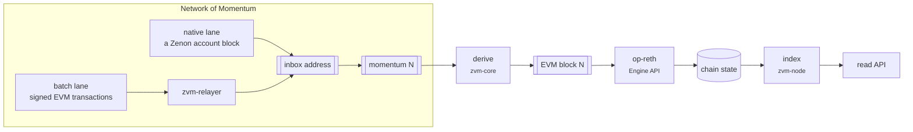
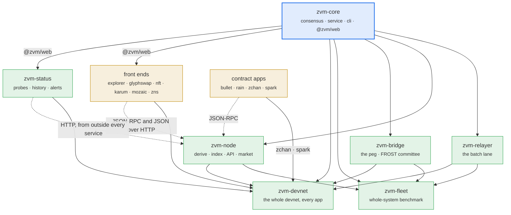
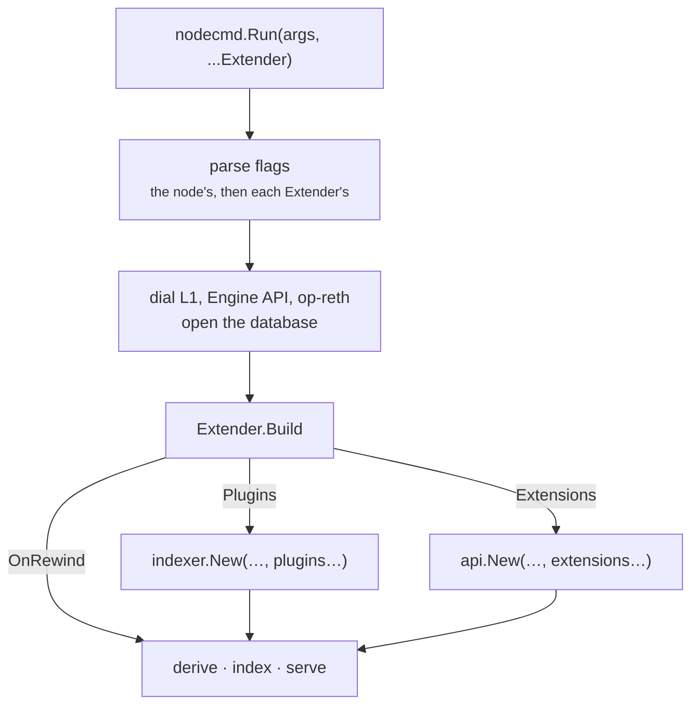
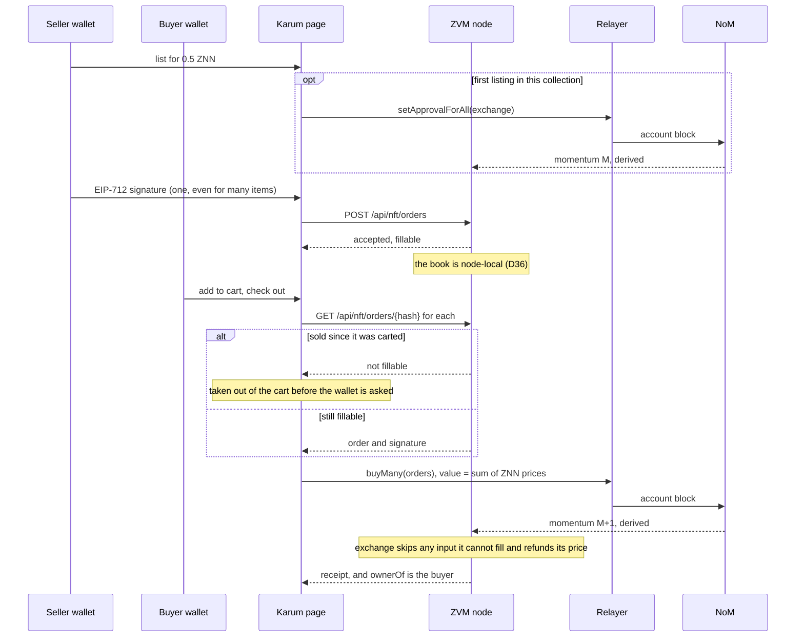

# Architecture

The ZVM is eighteen repositories in the
[Zenoglyphs-VM](https://github.com/Zenoglyphs-VM) organisation, each published,
built and tested on its own. This is what each one is, what it may depend on,
and why the lines fall where they do.

Everything below follows from one mechanism. Zenon orders and stores every
transaction; a node turns each momentum into exactly one EVM block and hands it
to a stock op-reth. There is no sequencer, so the order is whatever NoM
committed, and any node with the same NoM history rebuilds the same chain:



`derive` is the only function in that chain with no room for judgement: given
momentum N, every node must produce byte-identical block N or the chain has
forked. Which repository it lives in, and how many copies of it exist, is
therefore not an organisational question.

## The map



Solid arrows are build dependencies, and every one is a git submodule: the
dependent carries the repository it needs at a pinned commit (`./zvm-core`, and
in `zvm-fleet` also `./zvm-node`, `./zvm-relayer`, `./zvm-bridge`; in
`zvm-devnet` every service, page and app it runs), and a Go
module points at it with `replace … => ./zvm-core`, a front end with a Vite
alias and a tsconfig path. A clone with `--recurse-submodules` builds alone, and
moving to a newer core is a submodule bump made on purpose. Dotted arrows are
runtime: an app reads from whichever node its build or its user names, which is
not a build dependency in either direction.

There are no cycles, and no arrow points back up. `zvm-fleet` and `zvm-devnet`
are at the bottom because each runs every service at once — that is also why
neither can live inside any of them.

`zvm-status`'s prober shares no code with `zvm-core` on purpose: it is the one
process here that must not share code with what it watches. It talks to the
public paths over HTTP exactly as a stranger would, so a bug in a shared client
cannot make a broken service look healthy to it. Only its page compiles
`@zvm/web`, for the marks every page draws.

`zvm-bullet` has no arrow into `zvm-core` either, but for a plainer reason: it is
an application, a Telegram bot that owns one escrow contract, and it needs
nothing of the rollup beyond a JSON-RPC endpoint. It deploys on its own as
well: its bot, its page, its settings and its key are all in `zvm-bullet`
(`docker-compose.yml`, `.env`, `secrets/`), and the devnet's gateway holds only
the route that forwards `/bullet/` to it.

`zvm-rain` is the same shape and stands as far apart: a Telegram bot that splits a
sender's tokens evenly between the people who spoke in a group in the last few
minutes, through its own Rain contract. Its page, where a wallet signs the link
and the approvals the bot prepares, is built and served by its own container;
the devnet's gateway holds only the route that forwards `/rain/` to it.

`zvm-zchan` has no arrow into `zvm-core` either: an anonymous image board whose
every post is a call to its own ZChan contract, read back from the contract's
logs by a static page with no backend at all. The page builds with relative
paths and routes in the hash, so it is published unchanged to GitHub Pages and
to `/zchan/` on the devnet's gateway. `zvm-spark` is the same shape (a launchpad
in three contracts, read by a static page), and so are `zvm-mozaic` and
`zvm-zns`, which also compile `@zvm/web`.

`zvm-docs`, this one, is outside the graph because nothing imports it.

The monolith these were split from, `zvm`, is deprecated and not published.
What the repositories needed from it was copied out: the chain definitions are
in `zvm-core/chains/`, each service has its own Dockerfile, and the benchmark's
devnet stack is `zvm-fleet/devnet/` (dynamic plasma by default; the version 1
ruleset of go-zenon's master branch is deprecated). A devnet to build and test
apps on is `zvm-devnet`. The chain
69 deployment behind devnet.zenon.foo (its gateway, tunnel and committee) is
operated from that tree on the devnet's host, as described in
[operations/](operations/).

## Why a shared core, and not three copies

`zvm-core/derive` turns a momentum into an EVM block. That function *is* the
consensus: there is no sequencer to appeal to, so two nodes agree because they
compute the same thing from the same NoM history. Three services carrying their
own copies of it could read the same momentum and disagree about what block it
is, and nothing in the system would notice until they had built different
chains.

This is the Polygon CDK shape — zkevm-node and zkevm-bridge-service as separate
repositories over one pinned module — rather than the OP Stack shape, where
op-node, op-batcher and op-proposer are separate binaries that deliberately stay
inside *one* Go module sharing `op-service`. Both work. The thing that does not
work is separate repositories with no shared module.

`zvm-core` also holds the things that are not consensus but must not differ:
`service` (how a process stops, and how it waits for a dependency that is not up
yet), `cli` (flag names, the endpoint flags, `ParseUnits`, the JSON reply
shape), and `web` — the npm package `@zvm/web` that the front ends compile,
holding bech32, number formatting, the viem chain definition and the relayer's
tip floor.

A `parseUnits` that rounds in one binary and errors in another is a transfer off
by a factor of ten. An address that decodes to different bytes in two web apps
sends money to two different places. Neither is a style question.

## Why the node is one process and not four

`zvm-node` derives the chain, indexes it, verifies contracts, serves the read
API, and serves the NFT market. That is a lot for one binary, and the market in
particular looks like it wants to be its own service. It cannot be.

Who owns an NFT is derived from the same `Transfer` logs the chain's own index
reads. An L1 reorg rewinds both. A separate process indexing the same logs would
rewind on its own schedule, and between its commit and the node's it would be
answering "who owns this" for blocks that no longer exist. So the market is a Go
package the node is built with, in the same write transaction.

What it is *not* is tangled into `indexer.go`. There are two seams, and the
market goes through them exactly as an out-of-tree extension would:

```go
// api.Extension — routes, a slice of /api/info, and an outermost wrapper.
type Extension interface {
	Register(mux *http.ServeMux)
	Info() map[string]any
	Wrap(http.Handler) http.Handler
}

// indexer.Plugin — extra tables, filled from the same logs in the same
// transaction, with their own rewind and rebuild contract.
type Plugin interface {
	Name() string
	Attach(h Host) error
	Schema() string
	Handle(ctx context.Context, dbtx *sql.Tx, r LogRow) error
	Jobs() []Job
	Deletes() []string
	Restores() []string
	AfterBlock(dbtx *sql.Tx, block uint64) error
	Rebuild(dbtx *sql.Tx, block uint64) error
	Stale(db *sql.DB) bool
}
```

`nodecmd.Run(args, ...Extender)` is the whole node as a function. An `Extender`
puts its own flags on the node's flag set and is built once the clients are up,
before the index is opened — because what it returns decides which tables that
index has:



The order matters and is the reason `Build` is not called later: a plugin's
`Schema()` has to run before the index opens, and a plugin registered after the
first block is indexed would have tables with a hole in them.

## Why the front ends are separate, and static

`zvm-explorer`, `zvm-nft`, `zvm-glyphswap`, `zvm-karum`, `zvm-mozaic` and
`zvm-zns` have no backend of their own. Each is a static bundle that reads from
the node its build names (`VITE_ZVM_NODE`), or one chosen in the header and in a
`?rpc=` parameter so a link carries the node it was read from.
They deploy to GitHub Pages and they are useful against a devnet on a laptop, a
colleague's node, or a public one — none of which is true of a page baked into a
node's binary.

They are three repositories rather than one because they are three products. A
block explorer, a marketplace and a trading interface share a design system and
share nothing else; merging them would mean one deploy, one bundle, and three
audiences downloading each other's code.

What they *do* share is `@zvm/web`, resolved through a Vite alias and a tsconfig
path into the zvm-core submodule (`zvm-core/web/src`). Each `vite.config.ts`
pins `vue` and `viem` to that app's own copies, which guarantees one Vue
instance rather than two.

`zvm-glyphswap` is backend-free in a stronger sense: it reads Uniswap V2
straight off the contracts, so it works against a bare op-reth with no node API
in front of it. `zvm-explorer` and `zvm-nft` need the node's index — and
`zvm-nft` needs its order book, which is not on the chain at all.

`zvm-karum` is the second NFT front end, and the one meant for people rather
than for testing the market: OpenSea's and Magic Eden's shape (featured
collections, rankings, trait filters with rarity, a floor sweep, a cart that
checks out in one `buyMany`, bulk listing under one signature, drops, a
watchlist) over the same node API and the same signed orders as `zvm-nft`. Two
things about it differ from its siblings on purpose:

- **Its endpoint is an RPC URL, and the API is derived from it.** A person has
  a node's `…/rpc` to hand, so that is what the picker takes; the market API is
  that URL without `/rpc`. A bare op-reth passes the chain check and is then
  told it serves no market, because the order book cannot come from the chain.
- **Its motion runs whatever the OS reduced-motion setting says,** as every
  front end here does: browsing art is a different act from reading a ledger,
  and a market standing still on machines where nobody chose that is broken.

The full protocol a Karum purchase runs, since that is what an incident on it
would turn on:



## Where each thing lives

| Repository | What it is |
|---|---|
| **zvm-core** | `derive`, `rollup`, `l2`, `znn`, `store`, `devnet`, `ethrpc`, `service`, `cli`, `orderbook`, `faucet`, `vectors`, the `zvm` tool (`cmd/zvm`), `web/` (`@zvm/web`), and `chains/`, the committed chain definitions |
| **zvm-node** | derivation, index, contract verification, read API, the NFT market, the DEX's pools and prices, `bench`, `solcd`, `dex`, `verify-tokens`, and `contracts/` (the Solidity) |
| **zvm-relayer** | the batch lane: signed EVM transactions in, NoM account blocks out |
| **zvm-bridge** | the peg, and the FROST committee that signs its payouts |
| **zvm-fleet** | the whole-system benchmark, the L1 gossip healer, and `devnet/`, the stack it measures |
| **zvm-devnet** | one `docker compose up`: a fresh NoM chain 69 with dynamic plasma on go-zenon's dev branch, the ZVM on it, every service, every app deployed, every page, a sanity check and test data |
| **zvm-explorer** | blocks, transactions, addresses, tokens, contracts |
| **zvm-nft** | collections, items, and signed orders |
| **zvm-glyphswap** | Uniswap V2: swap, pools, charts |
| **zvm-karum** | the NFT marketplace for people: collections, rarity, cart, bulk listing, drops |
| **zvm-mozaic** | a shared 1000 x 1000 canvas, paid per pixel, and its page |
| **zvm-zns** | ENS on the ZVM: `.znn` names, ENS's contracts, and the page that registers them |
| **zvm-spark** | a launchpad: bonding-curve tokens that graduate into Glyphswap, comments and profiles |
| **zvm-status** | whether any of the above is answering: 30 days of checks, and the email when one is not |
| **zvm-bullet** | Bullet Game: Russian Roulette in Telegram for BULLET, on the token and escrow Ethereum ran, the bot that hosts the games, and its page at `/bullet/` |
| **zvm-rain** | Rain: a Telegram bot that splits ZNN or any ERC-20 evenly between whoever spoke in a group in the last few minutes, the contract it pays through, and its page at `/rain/` |
| **zvm-zchan** | zchan: one anonymous image board, `/z/`, kept in a contract's logs; handles for 1 ZNN, janitors who remove posts, and its page at `/zchan/` and on GitHub Pages |
| **zvm-docs** | this |

## Three ordering rules that are easy to get wrong

**The Solidity lives with the node, not with the market.** `zvm-node/contracts`
is one Foundry project holding the bridge and fee contracts, the benchmark's
tokens and Uniswap V2, and the application contracts. It is not split by
consumer because `zvm-node/verify` recompiles submissions against it, and half a
source tree verifies nothing. `zvm-nft` embeds the compiled artifacts.
The one exception is `zvm-bullet/contracts`: those are Bullet Game's Ethereum
contracts, pulled from mainnet with the verified source and compiled with the
0.8.19 settings mainnet used, and they stay beside the mainnet originals they
are checked against rather than join a project built with another compiler.
So does `zvm-rain/contracts`, for a smaller reason: Rain is one contract that
nothing else calls, built with the same 0.8.19 and deployed by its own bot's
command. `zvm-zchan/contracts` is the same case: one contract nothing else
calls, with the page's ABI generated from the same build.

**The chain definitions live beside the invariants they are checked against.**
`rollup.json` and `genesis.json` for every chain are in `zvm-core/chains/`,
because the invariants belong to `zvm-core/l2`, in particular that the
`L2ToL1MessagePasser` predeploy is present: Isthmus derives the header's
`withdrawalsRoot` from that account's storage root and op-geth and op-reth
disagree about a missing one (D2). The tests honour `ZVM_CHAINS` and **fail
rather than skip** when a definition is missing. A skipped genesis check is how
that split comes back.

**The vectors are the spec, and they sit with the code that computes them.**
`zvm-core/vectors/vectors.json` is built by `zvm-core/vectors` from the same
packages a node runs, the test checks the committed file against them, and
[spec/SPEC.md](spec/SPEC.md) is pinned by it. A golden file computed by a copy
of the code pins the copy, not the protocol. `ZVM_SPEC` points the test at
another copy, and a missing file fails rather than skips.

This is also why the NFT order's *encoding* is in `zvm-core/orderbook` while the
book that stores orders is in `zvm-node`. The vectors pin the EIP-712 hashing,
and a package that pins an encoding cannot depend on a database.

## Endpoints are configuration

No repository names a node in its source. Every endpoint a binary, a script or
a page talks to comes from the environment: `NOM_NODE` (a NoM node), `ZVM_RPC`
(the ZVM's JSON-RPC), `ZVM_NODE` (a node's base, its `/api` and `/rpc` under
it), `ZVM_RELAYER`, and for pages `VITE_ZVM_NODE`, `VITE_GATEWAY` (where the
other apps are) and `VITE_NOM_NODE`. Go flags default to them and fail naming
the variable when one is empty; a Vite build refuses to run without the ones it
needs. Each repository's `.env.example` has a local zvm-devnet's values, at
`http://localhost:47080`, and the Pages builds read them
from the organisation's Actions variables, so every published site is repointed
in one place.

A built-in default is a node every user of a tool leans on without choosing it,
and the first one to notice it moved is whoever's transaction did not land.

## Building and publishing

Every repository's CI (`.github/workflows/ci.yml`) builds and tests it on
Linux from a clean clone with its submodules: `go build`, `go vet` and
`go test` for Go, a typecheck and a build for a page. The sites (explorer,
glyphswap, karum, mozaic, zns, zchan, spark, status, bullet, rain) publish to
GitHub Pages from `pages.yml` on every push to `main`.
