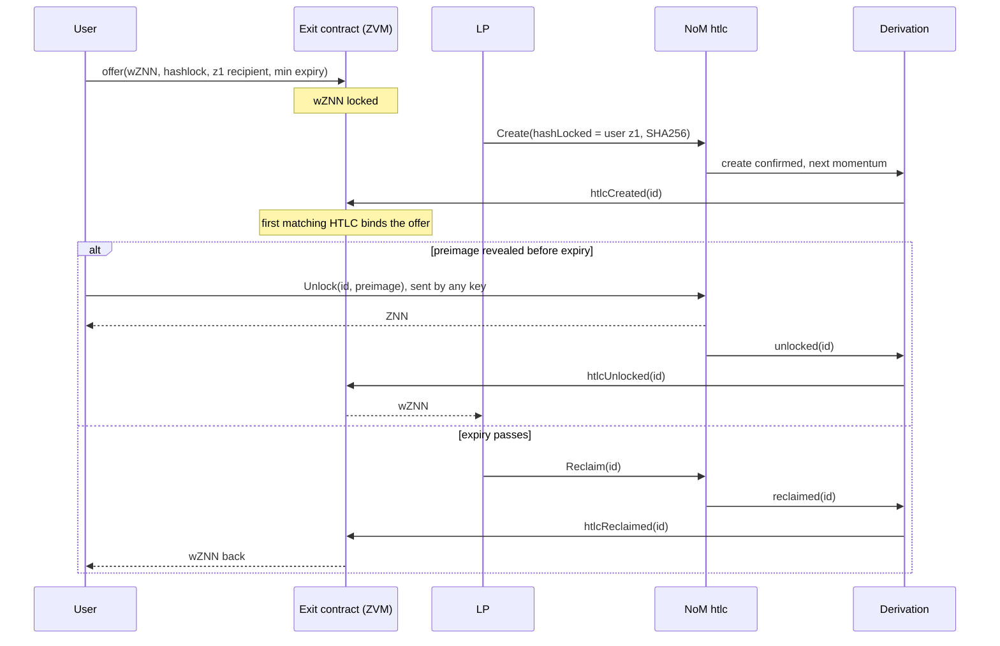

# Future improvements: what the ZVM could do with NoM, and what each one needs

**Collected 2026-09-28 from two design discussions: 2026-09-25 (peg-out, ZK, other
uses) and 2026-09-27 (HTLCs).** Nothing here is built or measured. Each item is checked
against the current spec. Where the earlier discussion has since been overtaken, the item
says so rather than repeating it.

Back to [zvm-docs](../README.md). Fork coordination is described in
[UPGRADES.md](UPGRADES.md). The former `HANDOFF.md` reference is unavailable in
this snapshot; it cannot establish an accepted implementation plan. The
[evidence inventory](../EVIDENCE.md#plans-and-operations) records that boundary.

---

## What every item below depends on

**The ZVM can read NoM for free. It can write to NoM only through a key.** Derivation is
a NoM observer, so anything that happened on NoM can become a fact in ZVM state with no
oracle and no light client. The only thing that can make NoM do something is a NoM
account's signature, and today that account is the committee vault (SPEC §7). One
exception needs no key of our own: the HTLC contract lets **anyone** call `Unlock`, and it
pays the address fixed in the entry, not the caller
(`go-zenon/vm/embedded/implementation/htlc.go:24-35`).

The items differ in what has to change:

| Needs | What that means | Cost |
|---|---|---|
| **contract** | A new L2 contract, and possibly a node or service policy | Deploy it |
| **ZVM fork** | A derivation rule at an activation height (SPEC §2) | A hard fork of the ZVM, per [UPGRADES.md](UPGRADES.md). No change to Zenon |
| **op-reth fork** | A change to the execution client | Stops the ZVM running a stock client (D2) |
| **spork** | A change to go-zenon's consensus | From about 2026-11-03. Sporks are not frozen: go-zenon PR #101 reopens the community spork window at momentum 14,567,887, to about 2028-09 |

Derivation has to do the verifying because contracts can't. Every NoM hash is NIST
SHA3-256, which the EVM cannot compute, and a momentum commits to no state root. Proving a
NoM fact inside a contract is therefore impractical
(`zenon-docs/protocol/light-client-primitives.md`).

## At a glance

| # | Improvement | Needs |
|---|---|---|
| 1 | NoM events and state as L2 input | ZVM fork |
| 2 | HTLC swaps settled by derivation | ZVM fork (builds on 1) |
| 3 | Committee accountability: refund on stall, slashable bond | contract |
| 4 | Canonical ERC-20 for every ZTS | ZVM fork |
| 5 | Minting on L2 from a NoM burn | ZVM fork |
| 6 | Fair ordering within a momentum | ZVM fork |
| 7 | Onboarding: fuse for a new address from L2 | contract + committee policy |
| 8 | Rollup fees to pillars and delegators | contract (weights from 1) |
| 9 | Airdrops through L2 | contract |
| 10 | Pillar-weighted scheduling of ZVM forks | contract + node |
| 11 | Rollups messaging each other through NoM | ZVM fork |
| 12 | Registering the ZVM with the embedded bridge | bridge administrator + ZVM fork |
| 13 | Client-side ZK sync and proof-gated committee signing | prover + signer policy |
| 14 | Ed25519 verification on L2 | op-reth fork |
| 15 | Trustless peg-out | spork |
| 16 | L2 contracts that act on NoM | spork (a committee version without one) |
| 17 | Pillar preconfirmations | spork, possibly not |
| 18 | A separate budget for batch data | spork |
| 19 | Paying sentinels for real work | spork |
| 20 | Momentum commitments for light wallets | spork |
| 21 | Encrypted mempool on the pillars' threshold key | spork |
| 22 | Synchronous L1↔L2 calls | spork (needs 15's enshrined form) |
| 23 | ZK sync for NoM itself | spork |
| 24 | NoM accounts controlled by L2 contracts | spork |

**Already built, and listed as an idea on 2026-09-25:** deposit-and-call. A send to the
vault carrying a `0x01` message mints and executes the call in the same block (SPEC §7,
*In*), so "bridge ZNN and swap" is already one Syrius signature.

---

## Without a spork

### 1 · NoM events and state as L2 input

Derivation is pinned to momentum *N*, so it can hand each L2 block NoM facts through a
system contract, and the result stays deterministic. `L1Block` already carries the
momentum's height, hash and timestamp. The candidates:

- HTLC create, unlock (with the preimage) and reclaim.
- Sends tagged for the ZVM that go to addresses other than the vault.
- ZTS issuance and burns.
- Pillars, their weights, sentinels and stakes.
- Accelerator-Z proposals and votes.

**Two costs.**
- **Derivation must start reading contract blocks.** SPEC §4 ignores them today, but an
  embedded call's outcome is decided in the contract's receive block, a momentum after
  the send (`zenon-docs/protocol/facts/latency-and-cost.md`). A mirrored `Create` that
  failed must not reach L2 as one that succeeded.
- **Mirrored events are mandatory messages** (§8). They share the mandatory share of each
  block and the deferral queue with deposits and payouts.

**Open question.** Can znnd serve state as of a *past* momentum? If not, derivation has
to rebuild that state from account blocks, and pillar weights are a sum over delegators'
balances.

### 2 · HTLC swaps settled by derivation

Prior art: Lightning's submarine swaps (Boltz) settle one leg by HTLC, and Across and Hop
give fast L2 exits by having a liquidity provider (LP) pay on L1 and be repaid on L2.
XCLAIM and BTC Relay released value on Ethereum when a Bitcoin payment was proven. Their
contracts paid gas to run a Bitcoin light client; the ZVM gets the same check free from
item 1.

What changes when the L2 leg is derived from NoM's HTLC events instead of being claimed:

- **One timelock instead of two.** A two-chain swap needs T2 < T1 with a margin for clock
  skew and the other chain's confirmation time; `projects/amm` uses T1 ≈ 5 min and
  T2 ≈ T1 + 15 min. The ZVM's block timestamp *is* the momentum's (SPEC §2), and the L2 leg
  settles in the same derived block as the NoM unlock. Nothing on L2 can expire, so the
  margin disappears. Short expiries become safe. That matters because a short expiry is
  how an LP limits the option a swap gives the user: the user can wait and reveal the
  preimage only if the price moves their way.
- **A fast exit without the committee**, drawn below.
- **Paying from NoM with one party acting.** A payer creates a NoM HTLC to a maker. The
  ZVM reserves the maker's L2 escrow when the create is derived, and the payer's own
  unlock releases it. The maker doesn't need to be online and nobody sends an L2
  transaction. This only matters when the maker wants native ZNN on NoM; for
  committee-backed wZNN, deposit-and-call already does it in one send.
- **Syrius's HTLCs become usable.** Syrius creates only `hashType` 0 (SHA3-256), which a
  contract can't check but derivation can.

- **The LP never acts after `Create`.**
- **The user never watches NoM.** The binding is visible in L2 state before they reveal
  anything, and the unlock can come from a key that holds no funds.
- **Losing costs time, not funds.** An LP whose HTLC loses the race only has its funds
  locked until expiry. If the unlock misses expiry (a plasma wedge on a dynamic-plasma
  chain, say), both sides are refunded.

**Latency (an estimate).** About five momentums, with one party acting. Compare the
committee path, which waits 30 momentums on mainnet (D17) and then a FROST round, and a
classic four-link HTLC swap, measured at 1 m 50 s on the devnet on 2026-09-13
(`latency-and-cost.md`).

**Caveats.**
- Check `embedded.htlc.getProxyUnlockStatus` on the recipient before binding. An address
  that denied proxy unlock can only be paid by unlocking from itself.
- The LP's wZNN is still backed by the committee. The committee has left the per-user
  path, not the system.
- Each HTLC call takes two of mainnet's 100 blocks per momentum, a budget every NoM user
  shares.

### 3 · Committee accountability

- **Refund on stall.** The bridge already learns from `markPaid` whether a withdrawal
  was paid. If no payout lands within *X* momentums, cancel the withdrawal and return the
  funds on L2. This covers liveness failures, not theft.
- **A slashable bond.** Members stake ZNN on L2, and a `PayoutAnomaly` (SPEC §7)
  slashes the quorum that signed it and repays the affected users. The bond has to exceed
  the vault, or theft still pays. This turns the existing theft flag into a deterrent
  whose size can be read.

Both live in `ZVMBridge`'s own state.

### 4 · A canonical ERC-20 for every ZTS

Other ZTS sent to the vault are ignored today, and the committee refunds them off-chain
(SPEC §7). A predeployed CREATE2 factory keyed by ZTS id would give every ZTS one
standard wrapper with no token pairs to curate. Its name, symbol and decimals come from
item 1.

### 5 · Minting on L2 from a NoM burn

The token contract's `Burn` is visible to derivation. Treating "burned *x* of this ZTS"
as permission to mint on L2 is one-way and fully trustless. It suits a token that will
live mostly on L2.

### 6 · Fair ordering within a momentum

The ZVM inherits NoM's `address ‖ height ‖ hash` order (D13), so a numerically lower
address trades first, which is why address grinders exist. Derivation could instead
shuffle each momentum's messages by a seed from the momentum hash. The producing pillar
can still bias the hash, so this removes grinding, not every advantage.

### 7 · Onboarding: fuse for a new address

A fresh Zenon account can't send until it has plasma, and fused plasma is usable only
about three momentums after the fusion (`zenon-docs/protocol/facts/based-evm.md`). An L2
onboarding contract could hold QSR and ask the vault to fuse for an address. The plasma
mirror (SPEC §7) already derives vault fusions back into ZVM state. Today this is only as
trustworthy as the committee; after item 16 it needs no trust.

### 8 · Rollup fees to pillars and delegators

Part of the fee D39 splits could go to a contract that pays pillars and their
delegators by the weights from item 1. Pillars order and store the ZVM's data and are
paid nothing for it. On mainnet, 96 % of momentums are empty (`protocol/facts/mainnet.md`),
so they have capacity to sell.

### 9 · Airdrops through L2

On NoM an airdrop costs one account block per recipient, out of the shared 100 per
momentum. One relayed batch on L2 pays thousands. Recipients claim under their Zenon
address's L2 spelling (D6) and need plasma only when they take the funds back to NoM.
`zts-airdrop` could target this.

### 10 · Pillar-weighted scheduling of ZVM forks

The ZVM's rule changes have the same governance gap as NoM's single-key sporks. An L2
governance contract could weigh votes by pillar weight (item 1) and set the momentum at
which a fork activates. The node would read that contract, which is where
[UPGRADES.md](UPGRADES.md) G2 currently has fork heights ship with the binary.

### 11 · Rollups messaging each other through NoM

Several based rollups on NoM all derive from the same momentums, so each can read what
the others sent to NoM. They share one ordering for messages, and no relayer sits between
their bridges.

### 12 · Registering the ZVM with the embedded bridge

The bridge administrator can call `SetNetwork(EvmClass, <ZVM chain id>, …)` and
`SetTokenPair` today, as mainnet already does for Ethereum and BNB. D14 names this as the
next step.
- **Peg-in becomes trustless.** Derivation reads `WrapTokenRequest`s straight from NoM.
- **Peg-out is still trusted.** Its trust moves from our committee to the pillar
  orchestrators' TSS.
- **Friction:** ZNN is the ZVM's native gas token (D16), so the orchestrators' ERC-20 mint
  path doesn't fit, and withdrawals need a contract that emits the events they expect.

### 13 · Client-side ZK sync and proof-gated signing

- **Client-side ZK sync.** A prover posts a validity proof for each range of momentums
  as NoM data. Wallets and new nodes check the proof instead of re-executing.
- **Proof-gated signing.** Committee signers refuse any payout without a valid proof.
  That catches bugs and a dishonest coordinator, but not *t* members who collude.

NoM still enforces nothing in either case. That needs item 15.

---

## Needs an op-reth change

### 14 · Ed25519 verification on L2

A precompile would let a Zenon account sign off-chain orders, permits and session keys.
D28 has since narrowed the need: a Zenon account now sells by putting its order on chain
with `approveOrders`, with ERC-1271 as the other way in. The cost is running a forked
op-reth instead of a stock one (D2).

---

## Needs a spork

### 15 · Trustless peg-out

NoM consensus has to learn the ZVM's withdrawals.
- **Enshrined execution.** Every znnd derives the ZVM, and momentum *N* commits
  `zvmRoot(N−k)`. The producer then either creates the payouts itself or accepts a Merkle
  proof against the root.
- **ZK validity proofs.** An embedded Groth16 verifier, with an inbox accumulator
  (`acc = H(acc ‖ block)`) so the proof is bound to the batches NoM ordered.
  - go-zenon already depends on go-ethereum v1.10.22 (`go.mod:8`), which ships the
    pairing code behind Ethereum's `0x08` precompile (`crypto/bn256`).
  - A Groth16 proof is about 260 bytes, well inside the 16 KB block cap.
  - The prover is untrusted, so it only affects liveness.

**Prefer ZK.** Enshrining makes every pillar run the EVM. At the 600 tx/s saturation
peak, op-geth used 7.2 cores and the pillar 0.16 (`benchmarks/BENCHMARK.md`, *Resources at
the ceiling*; measured on op-geth, before op-reth replaced it). It also makes an EVM bug an L1 consensus bug.
Optimistic fault proofs fit worst:
- each bisection round costs at least two momentums;
- the one-step verifier would be consensus-critical Go;
- NoM has no forced-inclusion lane to protect a challenger from censorship.

Either way, peg-out lands as a `ZvmClass` network in the embedded bridge. It swaps the
single ECDSA check in `UnwrapTokenMethod` and keeps the registry, redeem delay and halt.
A generic verifier also enables the Ethereum side:
`zenon-docs/ideas/zk-light-client-bridge.md`.

### 16 · L2 contracts that act on NoM

This generalises the automatic payout: an L2 contract emits an intent, and the momentum
producer turns it into an embedded-contract call. Examples:
- a DAO that runs a pillar;
- a vault that stakes and compounds;
- a contract that issues and manages a ZTS;
- limit orders that settle on NoM.

That makes the ZVM NoM's smart-contract layer without adding a general VM to L1.

**Without a spork there is a trusted version.** A FROST quorum can hold any z1 address
(`zenon-docs/protocol/facts/threshold-signatures.md`), so the committee could hold one
address per contract and sign the calls its intents describe. The trust is the
committee's, as for payouts today. Item 2's proxy unlock is the only part that needs no
trust.

### 17 · Pillar preconfirmations

A ZVM transaction can't confirm faster than a momentum. p50 is 7.2 s unloaded and 15.6 s
at 100 tx/s (`benchmarks/BENCHMARK.md`). The pillar scheduled for the next momentum would
sign a promise to include a transaction and be slashed if it doesn't, which brings
confirmation under a second. Based rollups on Ethereum are working on the same idea.
The 2026-09-25 discussion put the bond and the slashing condition in a spork.

**Not yet examined: it may not need one.**
- **Where the bond lives.** Derivation sees whether a promised transaction landed by
  momentum *M*, so the bond could sit in an L2 contract and be slashed there.
- **Binding the key.** The pillar would register an L2 signing key by a native-lane send
  from its own address, since the native lane already knows a sender's z-address.
- **The unsolved part.** The contract needs item 1's pillar list to know which senders
  are pillars, and a way to map a momentum to the pillar that produced it.

### 18 · A separate budget for batch data

Every NoM action shares 100 account blocks per momentum on mainnet, and ZVM batches draw
from that (`based-evm.md`). A data lane with bigger blocks, priced per byte like
Ethereum's blobs, would stop rollup load from delaying ordinary users.

### 19 · Paying sentinels for real work

Pay sentinels from emissions to store rollup data long-term, serve light-client proofs,
or run item 15's provers.

### 20 · Momentum commitments for light wallets

With a state root in the momentum header, Syrius can show L2 balances and verify them
against the momentum without trusting a ZVM RPC. The forum roadmap names this root as
what both fraud proofs and browser light clients depend on (topic 929).

### 21 · Encrypted mempool on the pillars' threshold key

Pillars already run threshold key generation for the bridge orchestrators. Users would
encrypt batches to that key, and pillars would publish decryption shares once a momentum
fixes the order. Nobody can read a transaction before its position is final, so
front-running is impossible.

### 22 · Synchronous L1↔L2 calls

With enshrined execution (item 15), an account block could call an L2 contract and use
the result in the same momentum. An example: swap on L2, then fuse the output on NoM,
atomically. No asynchronous rollup can offer this.

### 23 · ZK sync for NoM itself

Item 15's verifier could check a recursive proof of NoM's own history. A new node or a
browser would check one proof instead of replaying every momentum.

### 24 · NoM accounts controlled by L2 contracts

A new account type whose sends need an L2 contract's approval, through the committed
root or enshrined execution. It brings multisig, social recovery, spending limits and key
rotation to NoM, where today an address *is* its key.

---

## Where to start

| | Pick | Why |
|---|---|---|
| **No spork** | **2**, with the parts of 1 it needs | The only trustless exit available on mainnet, and it takes the second timelock out of every cross-chain swap |
| | **3** | Makes the committee economically accountable while 15 has no date |
| **Spork** | **16** | Turns the ZVM into NoM's programmable layer; 15 already builds most of what it needs |
| | **21** | Reuses threshold infrastructure the pillars already run |
