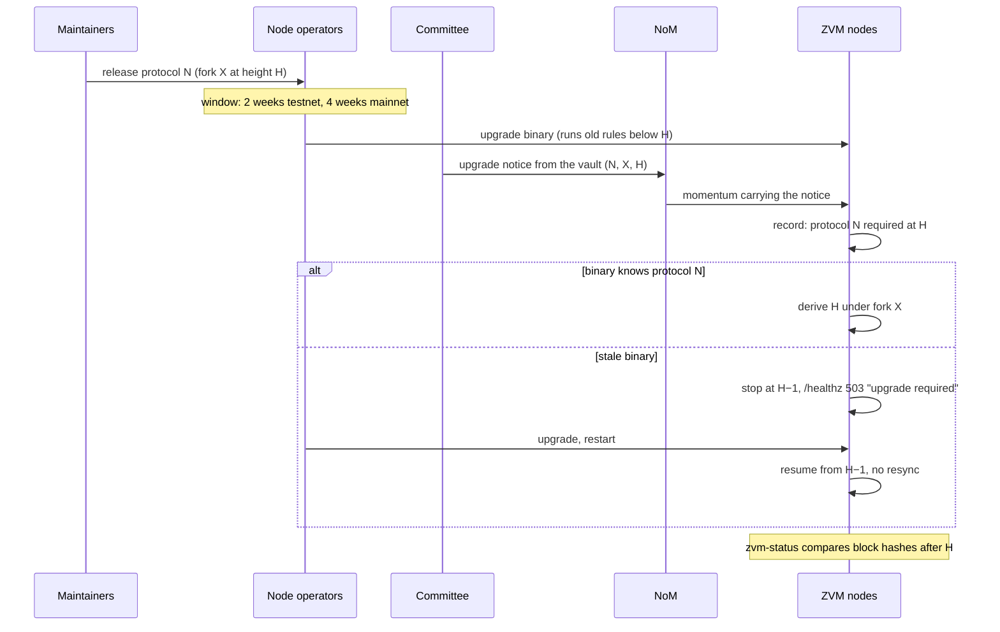

# Upgrading the node: how a rule change reaches every node

**Written 2026-09-22. A plan, not built.** How a change to the ZVM's derivation
rules gets from a merged pull request to every node that derives the chain, and
what happens to a node that does not take it.

---

## The short answer

**Yes, every rule change is a hard fork, and yes, adopting it is voluntary.**
Neither is a defect. A based rollup has no sequencer and no ZVM peer-to-peer
network: every node reads the same NoM momentums and derives the chain on its
own (D1). Nothing can push code into another operator's node, and nothing needs
to — a node that applies different rules simply computes a different chain.

What the plan controls is the two things that are actually dangerous:

1. **A stale node must stop, not diverge.** Today it diverges silently and keeps
   serving answers. This was demonstrated on chain 70 on 2026-09-15 (D9): after the
   burned fee activated, "a publisher still on the old config" derived the same
   NoM block as *valid* while its upgraded peers derived it as *invalid*, and
   both reported themselves healthy.
2. **The parties that decide what the ZVM is worth must move together.** That
   is the vault committee: it pays withdrawals out of the vault against its own
   nodes (COMMITTEE.md, "a signer must read its own NoM node and its own ZVM
   node"). A fork the committee does not follow can hold ZVM balances but cannot
   withdraw them. In this system that is the enforcement, and it already exists.

## What comparable systems do

| System | Where the fork height lives | What a stale node does | How it went |
|---|---|---|---|
| **Ethereum** | Baked into each client release, per chain id (`params/config.go`) | Keeps following the old rules; ends up alone on a dead chain | Works because five client teams and the operators coordinate off-chain, months ahead. Stale nodes are a real, recurring source of confusion on fork day |
| **OP Stack** | Timestamps in the chain config, from the superchain registry; the required version is also published on L1 (`ProtocolVersions`) | With `--rollup.halt=major`, **halts** when L1 demands a version it does not meet | This is the closest analogue: a derived chain with an on-L1 signal. The halt is opt-in, and most operators leave it off |
| **Cosmos SDK** | An on-chain governance proposal (`x/upgrade`) names a height | **Panics at that height** with `UPGRADE NEEDED`; Cosmovisor swaps the binary and restarts | Forks happen every few months with little drama. The halt is the reason |
| **Bitcoin** | Soft forks only, activated by miner signalling (BIP9/BIP8) | Keeps validating under the looser old rules | Avoids hard forks at the cost of years per change. Not available to us: see below |
| **Zenon (NoM)** | Sporks: code ships in go-zenon, and a transaction signed by the spork key activates it | Rejects the first block that uses the new rule, then forks off | The genesis key is lost, and no spork could be created between 2026-04-16 and the window that reopens about 2026-11-03 (zenon-docs `protocol/facts/mainnet.md`). **Activation must not depend on one key** |

**Why a soft fork is not available.** Bitcoin can tighten a rule so old nodes
still accept the new blocks. The ZVM has no blocks to accept, only momentums to
derive. An old node that sees a brotli batch (the wire fork) drops it as an
unknown flag, so it builds a block without those transactions. Every change to
derivation changes the derived block, which makes it a hard fork.

## What exists today

The mechanism for scheduling forks is already built. What is missing is enforcement:

- **Activation heights.** `rollup.Forks` (`gas`, `wire`) and the `feeMarket`
  schedule in `rollup.json`, spec §2 *Activation heights*. Every rule is gated
  by `momentum >= height` forever, so a node syncing from genesis re-derives
  each period under its own rules, and a binary that knows a fork can be run
  before its height.
- **Reporting.** `/api/info` → `l2.forks` says what is scheduled and what is
  live.
- **A rehearsed path.** On chain 70, the burned fee was activated eight
  momentums ahead by editing `rollup.json` and restarting the node (D9).
- **Stall detection.** `/healthz` returns 503 when derivation has stalled (HALT.md).
  That covers a node that *cannot* derive. It does not cover a node that
  derives the wrong chain.

The gaps, in order of how badly each can hurt:

| # | Gap | Consequence |
|---|---|---|
| G1 | `rollup.Load` uses plain `json.Unmarshal`, which ignores fields it does not know | An old binary given a new `rollup.json` that names a fork it lacks **ignores the fork and diverges silently**. This is the worst case, and it looks like a successful upgrade |
| G2 | Fork heights are per-operator config, not per-release | Two operators with different `rollup.json` files run different chains, and no check notices |
| G3 | Nothing on NoM says which rules apply | A node cannot learn that it is out of date. It can only disagree |
| G4 | Nobody compares derived blocks across nodes | A divergence shows up only when a user notices it |
| G5 | The EVM ruleset (`evm: karst`) is "written at genesis and never moves" | Every EVM upgrade so far (Isthmus→Karst) was a re-genesis. That is fine on devnet and impossible once the chain holds value |

## The plan

### 1. Classify the change first

Only a change to what a derived block contains needs a fork. A change needs a
fork if it touches `spec/SPEC.md` §4–§8, changes zvm-core's `vectors/vectors.json`, changes a
`rollup` parameter, or changes the EVM ruleset or genesis. A change to the
API, indexer, UI, relayer batching policy, or bridge policy does not: it ships
in an ordinary release, and operators can take it whenever they like.

**Rule: a pull request that changes `vectors.json` names its fork.** It adds a
field to `rollup.Forks`, gates every change behind `XActive(momentum)`, and
adds vectors for both sides of the height. `zvm vectors -check` already fails
when an encoding changes. The new requirement is that pre-fork vectors must
still pass unchanged.

### 2. Make a stale node halt instead of diverging (G1, G3)

This is the important step. It is the Cosmos and OP behaviour, and it is the
only step that turns silent divergence into a visible outage.

- **The binary declares what it implements.** `rollup.KnownForks` lists
  the forks this release can apply, and `rollup.ProtocolVersion` is an
  integer that goes up by one per fork.
- **Decode `rollup.json` strictly.** Use `DisallowUnknownFields` on
  `Config` and `Forks`. An unknown fork field is a startup error:
  `rollup.json schedules fork "x" that this binary does not implement: upgrade
  to protocol ≥ N`. This alone closes G1.
- **Publish the upgrade on NoM.** An *upgrade notice* is a new inbox message
  type: `0x0? ‖ rlp([protocolVersion, forkName, momentum])`, sent **from the
  vault**. The vault is the committee's FROST address, so a threshold of
  signers produces the notice, and no single lost key can stall upgrades (as
  one stalled Zenon's sporks from 2026-04-16 until the window reopening about 2026-11-03). Every node derives the notice like any other
  message.
- **Stop at the height, not after it.** A node that has derived a notice for
  a version above its own keeps deriving until `momentum − 1`, then stops. It
  does not exit: `/healthz` returns 503 with `upgrade required: protocol N at
  momentum H`, and `/api/info` carries the same text. This uses HALT.md's
  quarantine semantics with a clearer reason.
- **The notice schedules, and config confirms.** A fork is active only when
  both the binary and the chain agree. The binary's per-chain table (step 3)
  holds the height, and the notice must name the same height. A mismatch
  halts the node too. That way a compromised committee cannot activate code
  nobody shipped, and a release cannot activate a fork the committee never
  announced.

This makes the committee the body that announces upgrades. The committee
already decides which chain's withdrawals are paid, so this adds no new trust.
It does put that fact in writing. If the committee changes (resharing, D15),
upgrade authority moves with it.

### 3. Fork heights ship with the binary (G2)

Follow Ethereum: for a chain that holds value (testnet, mainnet), fork
heights are compiled into the release, keyed by `l2ChainId`. `rollup.json`
keeps its `forks` block for devnets and rehearsals. For a known chain id, any
fork height that differs from the compiled one is a startup error. Upgrading
the binary then means adopting the rules, and two operators cannot drift apart
through their config files.

### 4. Detect divergence from outside (G4)

`zvm-status` already probes nodes from outside and has no dependency on
`zvm-core`. Add one probe: read `eth_getBlockByNumber(h)` from every known
node, at a height every node has passed, and alert when the block hashes
differ. Also have each committee signer check, before signing a payout, that
its node's block hash at the withdrawal's height matches the coordinator's.
If they disagree, the signer refuses and reports why. The signers stay
independent, and a split becomes an alert instead of a quiet non-payment.

### 5. EVM upgrades by timestamp (G5)

op-reth activates OP forks by **timestamp** in the chain config. That is how the
superchain ships Isthmus, Jovian and Karst to running chains. An L2 block's
timestamp is its momentum's timestamp (spec §2), so an EVM fork is scheduled by
a wall-clock time, not by a momentum height. The node must stop treating `evm`
as fixed:

- Turn `Config.EVM` into a schedule, the way `feeMarket` became one:
  `[{from: <timestamp>, evm: "karst"}, …]`.
- Write the same timestamps into the execution client's `genesis.json`
  chain config, and check at startup that the engine's config matches, the
  same way the genesis-hash check works today (HALT.md path 9).
- Release a node and op-reth version as one pinned pair. A new EVM fork needs
  both, and the compose file pins both images by digest.

**To verify before relying on it:** that op-reth accepts a future OP fork timestamp
added to the chain spec of an already-running chain without a resync.
The superchain does exactly this, but we have not done it on chain 70.

### 6. The release timeline

Each fork goes through the same three stages:

1. **Rehearse on both devnets.** Chain 70 (v1 rules) and chain 71 (dynamic plasma), because the
   standing rule is that anything touching plasma, ordering or publishing is
   measured on both. Activate a few momentums ahead, run `verify:swap`,
   `verify:apps` and a short fleet run across the height, and keep one node on
   the old binary on purpose to confirm it halts at `H − 1`.
2. **Testnet.** The height is at least two weeks out, and the committee sends the notice
   once most known nodes report the new protocol in `/api/info`.
3. **Mainnet.** The height is at least four weeks out. The notice goes out only after
   the testnet fork has run clean for a week.

**Moving a fork.** Before `H`, a bug is fixed by a new release with a later
height and a new notice. The latest notice for a fork wins, and it must be sent
before the old height. After `H` there is no rollback: a fix is another fork.

**An emergency fix** (a derivation bug that loses funds) uses the same path
with a short window. Because stale nodes halt instead of diverging, a short
window costs operators an outage, not a chain split.

## Build order

| Step | Closes | Size | Needs a fork itself? |
|---|---|---|---|
| Strict `rollup.json` decode + `KnownForks` | G1 | small | no |
| `zvm-status` block-hash comparison | G4 | small | no |
| Signer checks block hash before a payout | G4 | small | no |
| Compiled per-chain fork table | G2 | small | no |
| Upgrade-notice message + halt at `H − 1` | G3 | medium | **yes**: a new message type is a wire change, so it activates at its own height, once, on each chain |
| `evm` as a timestamp schedule + engine config check | G5 | medium | no, until the first EVM fork uses it |

The first four steps are worth doing now: none of them is a fork, and G1 is a
real way to lose the chain today. The upgrade notice is the last fork that
must be coordinated by hand. After it activates, later forks are announced on
chain.

## Open for the operator

- **Who sends the notice.** This plan says the committee's threshold, since it
  already decides which chain gets paid. The alternative is a separate upgrade
  key or multisig, which is OP's model (the Security Council owns
  `ProtocolVersions`). That separates *announcing rules* from *custodying
  funds*, but it adds a second set of keys that can be lost.
- **Windows.** Two weeks for testnet and four for mainnet are borrowed from OP
  and Ethereum. Nobody runs this chain yet, so they can be shorter now and
  longer later.
