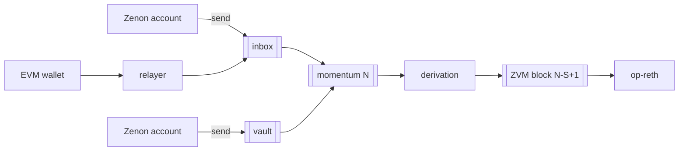
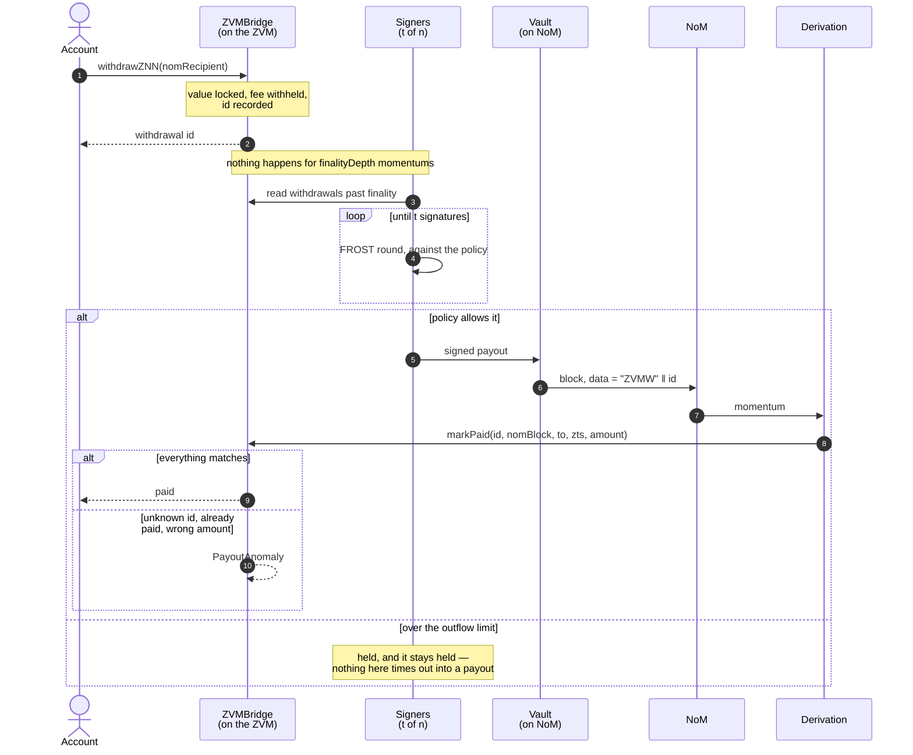

# ZVM — a based EVM rollup on the Network of Momentum

**Version 0.3, 2026-09-16.** This is the prototype's consensus: everything two
independent nodes must agree on to build the same chain from the same NoM
history. Anything not in this document is an implementation detail and may
differ between nodes (indexes, APIs, the explorer, how a relayer chooses what
to post).

It follows option 4 of *Mainnet-Adjacent State Machine* (2026-09-11) —
"zenoglyphs-lite", Path A — and it needs no change to Zenon: no spork, no new
embedded contract, no pillar cooperation.

---

## 1. The shape of it

NoM orders and stores transactions. A **derivation node** reads momentums in
order, turns each one into exactly one EVM block, and hands that block to a
stock OP Stack execution client over the Engine API — **op-reth** here, since
Karst needs it — which executes it. Nobody sequences anything: the order is
whatever NoM committed.



A node that has the same NoM history builds the same ZVM chain, byte for byte.
Losing every ZVM node loses nothing but the index: the inputs are on NoM, which
never prunes.

## 2. Parameters

| Parameter | Value in this prototype | Where |
|---|---|---|
| L1 (NoM) chain identifier | 69, go-zenon's devnet, with dynamic plasma (70, momentum v1, is deprecated) | `nom/genesis.json` |
| L2 chain id | `7_340_400 + L1 chain id` = 7340469 | `l2/rollup.json` |
| First derived momentum, *S* | 2 | `l1StartHeight` |
| L2 genesis timestamp | the timestamp of momentum *S-1* | derived |
| Block gas limit | 300,000,000 | `gasLimit` |
| Gas per plasma (native lane) | 16 | `gasPerPlasma` |
| Max gas for one native call | 16,777,216 | `maxNativeGas` |
| Burned fee for native calls | active from momentum 10 | `fee.fromHeight` |
| Max gas for a call carried by a deposit | 1,000,000, once the fee rule is active | `maxDepositCallGas` |
| Max native gas per block | 150,000,000 (half the block), until the gas fork | `maxNativeGasPerBlock` |
| Native lane's share, from the gas fork | floor 2,500 bp, ceiling 7,500 bp of the block | `nativeFloorBp`, `nativeCeilBp` |
| Mandatory share, from the gas fork | 5,000 bp of the block; the rest waits (§8) | `mandatoryShareBp` |
| Max gas for one relayed transaction | **16,777,216** here, EIP-7825's cap, which karst enforces | `maxTxGas` |
| Gas fork height | 200 | `forks.gas` |
| Wire fork height | 200 | `forks.wire` |
| Fee splitter | `0xe5e7d41F617F5CDa650d6485056F55f766cB5fC0` | `feeSplitter` |
| Chunk lifetime | 8,640 momentums (about a day) | `chunkTtl` |
| Max assembled payload | 524,288 bytes | `maxAssembledBytes` |
| Max decompressed batch | 4,194,304 bytes | `maxBatchBytes` |
| Finality depth | 6 momentums | `finalityDepth` |
| EVM rules | **`karst`** here: the Osaka EVM with Jovian's minimum base fee (`isthmus` is Prague) | `evm`, `l2/genesis.json` |
| Minimum base fee | 1,000,000 wei; only meaningful on karst | `minBaseFee` |
| Withdrawal fee | 25 bp, at least 0.01 ZNN or 0.1 QSR (§7) | `bridgeFee` |

**L2 block *n* is momentum *S + n − 1*.** Block *n*'s timestamp is that
momentum's timestamp. An empty momentum still produces a block.

### Activation heights

Three of this chain's rules change at heights it configures, and each is off
unless `forks` names a height. A node must apply each rule from its height
exactly, or it builds a different chain from that momentum on.

| Fork | What changes | Sections |
|---|---|---|
| **gas** | `mine_boost` as a fifth call item; the elastic native share; chunk gas counting the whole payload, each chunk once; the relayed fee split, the burn mirror and the plasma mirror; mandatory messages capped per block and deferred rather than forced | §5, §6, §7, §8 |
| **wire** | compression flags `0x02` brotli and `0x03` span | §5 |
| **market** | the chain's own EIP-1559 parameters replace the ones genesis baked in, and change again at each later entry | §8 |

The gas fork requires this chain's burned-fee rule (§6) to be active at or
before its height: a boost is a share of a burn, and without a burn there is
nothing to divide.

The market fork is a **schedule** rather than a single height: `feeMarket` is a
list of `{momentum, denominator, elasticity}`, oldest first, each strictly later
than the one before. Every entry needs all three, and may also carry
`minBaseFee`, Jovian's floor under the base fee from that momentum — on a chain
sitting below its target the floor *is* the price, so it belongs to the same
schedule and for the same reason. A schedule is necessary
rather than tidy — parameters worth tuning get tuned twice, and the blocks built
under the old ones still have to be re-derivable, so each period keeps its own
values forever.

## 3. Addresses

| Name | Address | Note |
|---|---|---|
| Inbox (NoM) | `z1zvmxxxxxxxxxxxxxxxxxxxxxxxxxxxxxafdtd6` | type byte `0x13`: no key and no embedded contract can reach it |
| Vault (NoM) | `z1qqtvzd4x2n729hwc777cusvr7u6z4uzzq8aq6z` | the committee's address; deposits are sent here |
| L1Block | `0x4200000000000000000000000000000000000015` | OP Stack's predeploy, carrying the momentum |
| ZVMBridge | `0x4200000000000000000000000000000000000100` | withdrawals and QSR |
| WrappedQSR | `0x4200000000000000000000000000000000000101` | bridged QSR, 8 decimals |
| L1 info depositor | `0xDeaDDEaDDeAdDeAdDEAdDEaddeAddEAdDEAd0001` | sender of the first transaction of every block |
| System depositor | `0xDeaDDEaDDeAdDeAdDEAdDEaddeAddEAdDEAd0002` | sender of derived bridge calls |

**One account, two spellings.** A NoM address and an EVM address are both 20
bytes, and the ZVM treats them as the same account. `z1…` is the bech32 form
of those bytes with the `z` prefix; `0x…` is the hex form. A NoM user address
always has `0x00` as its first byte, so any address that does not is reachable
on the ZVM but has no NoM key behind it.

Changing the vault is a configuration change, not a protocol change: the inbox
is the protocol's identity, and it is unspendable by construction.

## 4. Inputs

Derivation reads one momentum at a time through
`ledger.getDetailedMomentumsByHeight`, whose `blocks` array is index-parallel
to `momentum.content`. A node must verify that parallelism before using it.

Only **user send blocks** (`blockType == 2`) matter, and only these three:

1. `toAddress == inbox` — a ZVM message (§5). Any amount it carries is burned:
   the inbox's type byte is one no key and no embedded contract can produce, so
   nobody can spend what is sent there. Once the fee rule is active (§6) that
   burn is what buys a native call its gas.
2. `toAddress == vault` and `amount > 0` — a deposit (§7).
3. `address == vault` and `data` begins `ZVMW` — a payout marker (§7).
4. from the gas fork, `address == vault` and either
   `toAddress == inbox` with `data` beginning `ZVMB` — a burn mirror (§7) — or
   `toAddress == z1qxemdeddedxplasmaxxxxxxxxxxxxxxxxsctrp` with `data`
   beginning NoM's `Fuse(address)` selector — a plasma mirror (§7).

Everything else in the momentum is ignored, including receive blocks, contract
blocks, and sends to the inbox with no data.

**Order is NoM's order**: the momentum's content order, which go-zenon sorts by
`address ‖ height ‖ hash`. A node must not reorder. Address grinding therefore
buys priority, as it does on NoM itself.

## 5. Messages

A message is the `data` field of a send to the inbox. Its first byte is the
type.

### 0x01 — native call

```
0x01 ‖ rlp([to, value, gas, data])
0x01 ‖ rlp([to, value, gas, data, boost])    from the gas fork only
```

`to` is empty (contract creation) or 20 bytes. `value` and `gas` are
minimal-length big-endian integers; RLP's canonical rules apply and a
non-canonical encoding makes the message invalid. The message carries no
signature: the NoM block is already signed, and its author is `msg.sender`.
NoM's account height is the replay protection.

**`boost` is a fifth item, and only from the gas fork.** Before that height a
five-item list is not a call and the message is invalid. From it, the boost is
the part of the block's burn that buys *admission priority* rather than gas
(§6): the fee is computed on `amount − boost`, a boost larger than the amount
makes the message invalid, and a zero boost must be written as four items, so
that one call has one encoding.

It derives to a deposit-type transaction (`0x7E`) with:

| Field | Value |
|---|---|
| `sourceHash` | `keccak256(bytes32(0) ‖ keccak256(nomBlockHash ‖ bytes32(0)))` |
| `from` | the NoM block's author |
| `to`, `value`, `data` | from the message |
| `mint` | none |
| `gas` | §6 |
| `isSystemTransaction` | false |

### 0x02 — relayed batch

```
0x02 ‖ flag ‖ payload        flag: 0x00 raw, 0x01 zlib,
                             0x02 brotli, 0x03 span — both from the wire fork
payload = rlp([tx₁, tx₂, …])  each txᵢ an EIP-2718 encoded transaction
```

Flags `0x02` and `0x03` are unknown before the wire fork, and a message using
one there is invalid. `0x02` is brotli over the same payload. `0x03` is
**span**: brotli over the transactions' fields stored column by column, so that
the chain id, gas price, gas limit and recipients that repeat across a batch
sit next to each other instead of being separated by 65 random bytes of
signature. A decoder rebuilds each transaction from the columns and re-encodes
it, and a transaction that does not come back byte for byte is never sent this
way. The layout and a worked case are pinned in zvm-core's `vectors/vectors.json` under
`forks.span`. Measured on 200 transfers: zlib-9 0.605 of raw, brotli-6 0.582,
span 0.564.

Decompression is bounded by `maxBatchBytes`; a payload that exceeds it makes
the message invalid. Each transaction is then checked, and **dropped**
individually (the rest of the batch stands) when:

- it is not type 0, 1, 2 or 4 — in particular a deposit (`0x7E`) is never
  accepted from a batch, which is what stops a relayer minting;
- it is replay-protected and its chain id is not the ZVM's;
- its gas limit is above `maxTxGas`;
- its signature does not recover;
- it is already in this block;
- it does not fit (§6).

A dropped transaction is not in the block. It is not invalid forever: the same
signed transaction can be posted again.

### 0x03 — chunk

```
0x03 ‖ bytes
```

Stores bytes under the NoM block's hash. It produces no transaction.

### 0x04 — assemble

```
0x04 ‖ rlp([chunkHash₁, …])   1..64 hashes
```

The chunks are concatenated in order and the result is interpreted as a message
(only `0x01` or `0x02`). Each chunk must have been published **by the same
account**, no earlier than `chunkTtl` momentums ago, and no later than this
momentum. The assembled payload is bounded by `maxAssembledBytes`.

This is how a payload larger than NoM's 16 KB block limit gets in: a 22 KB
contract deployment is two chunks and an assemble.

## 6. Gas

**A native call's gas is what its NoM block paid for**, in plasma and — once
this chain's fee rule is active — in burned ZNN or QSR:

```
gas = min( plasma × gasPerPlasma ,
           feeGas ,                              only while fee.fromHeight ≠ 0 and height ≥ it
           maxNativeGas ,
           requested ≠ 0 ? requested : ∞ )

plasma = usedPlasma                                    a 0x01 message: its own block
       = usedPlasma + Σ 21000 + 68×(1+len(chunkᵢ))    from the gas fork, an assembled one
```

`usedPlasma` is the account block's own field, so it is part of NoM's consensus
and not re-derived.

**Chunks, from the gas fork.** A call that arrives in pieces is priced by the
whole payload: the assemble's own plasma plus each chunk's, where a chunk's is
recomputed from its stored bytes rather than read from a field, so a node that
kept the chunk before this rule existed reaches the same number as one
re-deriving today. **Each chunk is spent by the first assemble that names it**;
a later assemble naming a spent chunk is invalid, and so is one that names the
same chunk twice. That is what stops publishing chunks once and assembling them
twice from buying the gas twice. Chunks behind an assemble that produced no
transaction are not spent, and can be assembled again.

**The fee.** A native call may destroy ZNN or QSR by sending it to the inbox,
which nobody can spend from. What that burn buys is

```
feeGas = ⌊ amount × gasPerSupply × priceDen ÷ (supply(token, epoch) × priceNum) ⌋

supply(token, epoch) = refZnn or refQsr, plus NoM's published emission for every
                       epoch after refEpoch (4,320 ZNN and 5,000 QSR per epoch
                       once both reward tables are past their last entry)
epoch                = ⌊ (momentum.timestamp − fee.genesisTimestamp) ÷ 86400 ⌋
priceNum/priceDen    = paid ÷ base, floored at 1, where
                       base = 21000 + 68 × len(data) and
                       paid = fusedPlasma + difficultyToPlasma(difficulty)
```

Three things follow, and each is deliberate:

- **The price is a fraction of the token's own supply**, computed from a
  declared curve rather than an observed one, so every node reaches the same
  number offline and years apart, and the fee holds its value as NoM's
  perpetual emission inflates supply. Each token is priced against its own
  supply, so there is no exchange rate anywhere in the rule.
- **Congestion is read off the carrier block**, not off the momentum header:
  under dynamic plasma a block must pay more plasma per byte when NoM is busy,
  so the ratio of what it paid to what its bytes nominally cost is the price it
  met. On a v1 momentum, and on an uncongested v2 one, the ratio is 1.
- **A message that burns nothing buys nothing.** Once the rule is active a
  `0x01` message whose block carries no ZNN or QSR is **invalid** and derives to
  no transaction at all, rather than to a call with a budget it cannot run on.

Amounts in any other ZTS buy no gas. There are no refunds: an overpaid fee is
burned, so choosing the fee is choosing the gas limit.

**Relayed transactions pay ordinary EVM gas** on the ZVM, priced by EIP-1559
with OP's post-Canyon parameters (denominator 250, elasticity 6). The L1 data
fee is zero: the L1Block predeploy's fee fields are set to zero, so op-geth's
cost function returns zero.

**Admission.** Transactions are added in order while

```
gasSoFar + gasReservedForMandatory + gas ≤ gasLimit
```

and, for native calls only, while `nativeGasSoFar + gas ≤ maxNativeGasPerBlock`.

**From the gas fork the two lanes are elastic instead.** The native lane is
guaranteed a floor of the block and may grow into whatever the batch lane
leaves, up to a ceiling; the batch lane gets the rest, and is capped so the
floor survives. Only the *order of admission* changes — the block is still
executed in momentum content order.

```
        0%                 25%                            75%          100%
block:  |------------------|------------------------------|-------------|
                         floor                         ceiling

no native demand        ..................................................  relayed takes the block
                        `-- nothing is held back: the floor follows demand

a little native         ##................................................  only what it asks for
                        `- native

native heavy,           ####################################..............  native up to the ceiling
  relayed quiet         `------------- native -------------'

both heavy              ############......................................  the floor is held
                        `- native -'`------------- relayed ---------------'
```

The rule, in two passes over the same ordered list:

```
reserve    = min(native demand, floor)        hold back only what the lane asks for
relayedCap = min(gasLimit − floor, optional − reserve)
nativeCap  = min(ceiling, optional − relayedGas)
```

where `optional` is the block minus what mandatory transactions reserved. Pass
one admits relayed transactions in content order up to `relayedCap`; pass two
admits native calls up to `nativeCap`, **in descending boost** — the priority a
caller buys by burning more than its gas needs — with ties keeping content
order. A momentum in which nobody boosts is admitted exactly as it would have
been without the rule.

**What a boost is worth** is `feeGas(boost)`: the same fraction-of-supply
arithmetic as the fee, so a boost in ZNN and a boost in QSR are comparable
without an exchange rate anywhere in the rule.

**The relayed fee split.** From the gas fork a block's `coinbase` is the
`feeSplitter` address rather than the sequencer fee vault, so every relayed
transaction's priority fee accrues there. After the user transactions,
derivation appends one system call:

```
ZVMFees.settle(momentum, relayers[], weights[])
```

naming each account that posted a batch in this block and the gas its admitted
transactions declared, ordered by weight and then by address, capped at 32
authors. The contract credits each relayer half of its share and sends the rest
to `0x000000000000000000000000000000000000dEaD`. The call is on the `fees`
lane: unlike a deposit it may be dropped, and if it is, the fees stay for the
next block. The base fee is not in the split — EIP-1559 sends it to the
base-fee vault, which has no code and no key, so it is burned already.
Deposits and payout markers are **mandatory**: their gas is reserved before any
optional transaction is admitted, because the value they record has already
moved on NoM. Everything else is optional and is dropped when it does not fit.

**The engine has the last word.** After the list is built, the engine may still
refuse a relayed transaction (a nonce that moved, a balance spent by an earlier
transaction in the same block). Derivation removes exactly that one and
rebuilds. This is deterministic: the same inputs and the same execution rules
produce the same sequence of removals.

*How* the refusal is learned is not consensus, because it depends on the
client: op-geth names the transaction in its error, another client may simply
build the block without it. So a node also compares the payload it gets back
against the list it asked for — whatever is missing was refused, and anything
present that was never planned means the engine built a block this node did not
derive, which is never acceptable. A refused *deposit*, *payout*, *burn mirror*
or *native call* is a consensus failure, not a drop, and the node must stop.
`docs/HALT.md` enumerates those paths and what each one costs.

## 7. Value

### In

A send of ZNN to the vault derives to a deposit transaction with
`mint = amount × 10¹⁰` (NoM has 8 decimals, the ZVM 18), `from` and `to` both
the sender, `gas` 21,000. Nobody signs it; every node derives it from the same
NoM block.

If that same block's `data` is a `0x01` message, the mint happens **and** the
call executes with the minted value available (`to`, `value`, `data`, gas from
§6). If the call cannot fit the block, the mint still happens alone.

A deposit's amount is bridged, not burned, so a call carried by a deposit is
priced by its plasma alone — and, once the fee rule is active, capped at
`maxDepositCallGas`. Without that cap the deposit path would be the way to buy
native gas for nothing.

A send of QSR to the vault derives to a system deposit calling
`ZVMBridge.depositQSR(nomBlock, to, amount)`, which mints WrappedQSR. Other ZTS
are ignored; the committee refunds them off-chain.

### Out

`ZVMBridge.withdrawZNN(nomRecipient)` (payable, `msg.value` a whole number of
NoM base units) or `withdrawQSR(nomRecipient, amount)` records a withdrawal and
locks the value (ZNN stays in the bridge; QSR is burned). The recipient's first
byte must be `0x00`: a payout to any other address would be unspendable on NoM.

A withdrawal pays a **fee**: `bridgeFee.bps` of the amount, never less than the
token's floor, exactly as Zenon's own bridge charges `FeePercentage` on a wrap.
The fee is not paid out — the vault keeps it — so what the recorded withdrawal
says, and what the payout must send, is the amount *after* the fee. It is
contract state, not derivation: `feeFor(zts, amount)` answers it and
`feesZNN`/`feesQSR` accumulate it.

The committee pays it from the vault after `finalityDepth` momentums, tagging
the payout:

```
data = "ZVMW" ‖ bytes32(withdrawal id)
```

Derivation turns that NoM block into a system call to
`ZVMBridge.markPaid(id, nomBlock, to, zts, amount)`. The contract records the
payment when it matches, and emits `PayoutAnomaly` when it does not: unknown
id, already paid, or wrong recipient, token or amount. **A payout the committee
invents is visible in ZVM state**, which is the audit this design buys.

Because that is six parties and two waits, and because which of them is waiting
is the whole point:



Two things the diagram says that the text above it does not. The wait is the
**account's**, not the committee's: a withdrawal is irreversible from step 1,
and the only thing standing between the burn and the payout is a quorum that
may decline. And `PayoutAnomaly` is a message from the bridge to *itself* — no
one is told, nothing is reverted, and the value has already left the vault. It
is a record for whoever is reading, which is why somebody has to be.

### The burn mirror

From the gas fork, a send **from the vault to the inbox** whose data begins
`ZVMB` is the committee destroying, on NoM, ZNN the fee splitter burned on the
ZVM. It must carry ZNN and a positive amount. It derives to a system call to

```
ZVMFees.markBurnedOnNoM(nomBlock, amount × 10¹⁰)
```

so ZVM state records how much of its own burn NoM's supply has actually lost,
and anyone can read the gap. Nothing else about it is special: the inbox is
unspendable, so the value is gone whether or not the call succeeds.

### The plasma mirror

Also from the gas fork, a send **from the vault to NoM's plasma contract**
carrying QSR, whose data begins the `Fuse(address)` selector, is the committee
fusing the withdrawal fee's QSR into plasma. It derives to a system call to

```
ZVMBridge.markFused(nomBlock, beneficiary, amount)
```

The vault's own funds are the peg's backing, so every movement of them is
derived back into ZVM state: a payout, a burn mirror, and this. What it buys is
that `feesQSR − fusedQSR` — the fee revenue not yet spent on plasma — is
readable from ZVM state alone, which is what a committee member checks before
agreeing to fuse more. A malformed fuse is still recorded: NoM decides whether
it fused, and a refused fuse is refunded to the vault, so counting it errs
towards fusing less.

## 8. Block assembly

Every block's transactions, in order:

1. the **L1 info deposit**: `from` the L1 info depositor, `to` L1Block, gas
   1,000,000, calldata the Isthmus `setL1BlockValuesIsthmus` layout (176 bytes)
   carrying the momentum's height, hash and timestamp, with zero fee fields and
   the inbox as `batcherHash`. op-geth derives receipt fields from this
   transaction, so it is mandatory in every block;
2. then, in momentum content order, whatever §5 and §7 produced;
3. last, from the gas fork and only when the block carried a batch, the fee
   split (§6).

On `karst` the L1 info deposit is Jovian's 178-byte layout — selector
`0x3db6be2b`, the Isthmus fields, and a trailing `uint16` DA-footprint gas
scalar which is **zero**: that scalar prices data posted to Ethereum, which this
chain does not post, so Jovian's second metering rule is inert here.

### Mandatory messages, and what happens when there are too many

Deposits, payouts, burn mirrors and plasma mirrors are **mandatory**: the value
they record has already moved on NoM, so a node may not drop one. Their gas is
reserved before anything optional is admitted.

From the gas fork they may reserve at most `mandatoryShareBp` of the block
between them. What does not fit is **deferred**: it is applied by a later block
instead, in the order it arrived, ahead of that block's own mandatory messages.
The queue is strictly first in, first out — once one message waits, every later
one waits — so no message overtakes another, and every node defers the same
ones. A deferred message is recorded as `deferred` and produces no transaction
until the block that applies it.

Deferral is what stops a momentum with more mandatory messages than a block can
hold from stopping the chain: before it, a node that could not fit them all had
no safe move but to halt (`docs/HALT.md`, path 6). A mint one block later is
still correct; a chain that stops is not. Because the queue is derivation input
like the chunk store, a node that rewinds must forget what the rewound
momentums queued and released.

Payload attributes: `timestamp` the momentum's, `prevRandao` and
`parentBeaconBlockRoot` the momentum hash, `suggestedFeeRecipient` the sequencer
fee vault — **the fee splitter from the gas fork** — `withdrawals` empty,
`gasLimit` as configured, `minBaseFee` on karst when one is configured,
`noTxPool` true, and `eip1559Params` as below.

### The fee market

`eip1559Params` is eight bytes, `denominator` then `elasticity`, big-endian.
All zero means the execution client keeps the parameters genesis baked into its
chain config, and that is what every block before the first `feeMarket` entry
carries. From each entry's momentum a node writes that entry's `denominator`
and `elasticity` into every block instead, until the next entry.

This changes no execution rule — Holocene made the parameters a per-block input
precisely so a chain could change them without one — but it changes the base
fee of every block after it, and the base fee is state. Two nodes that disagree
about the height build different chains from it.

    target   = gasLimit / elasticity
    baseFee' = baseFee + baseFee × (gasUsed − target) / target / denominator

bounded below by the `minBaseFee` in force at that momentum on karst: the
schedule's newest entry that sets one, or the chain's own before the schedule
starts. A denominator is a *per-block* damping
constant, so it only means what the block time makes it mean: OP's 250 is
chosen for two-second blocks, and a chain deriving one block per momentum
applies it roughly seven times more slowly in wall-clock terms.

**Contracts can read NoM**: `L1Block.number()`, `.hash()` and `.timestamp()`
are the current momentum's, and EIP-4788's beacon-roots contract holds the
momentum hash for the block's timestamp.

## 9. Finality and reorgs

An L2 block is *soft* the moment its momentum is committed. It is labelled
**finalized** when its momentum is `finalityDepth` below NoM's frontier; that is
the label `eth_getBlockByNumber("finalized")` returns, and what the committee
waits for before paying.

go-zenon does not reorganise in normal operation. If a node nonetheless finds
that a momentum's `previousHash` does not match what it derived, it walks back
to the newest momentum it and NoM agree on, moves op-geth's head there with
`engine_forkchoiceUpdated`, drops everything above it, and re-derives. The ZVM
reorganises exactly when and where NoM does — never on its own.

## 10. What is deliberately not here

- **No trustless exit.** NoM cannot verify a proof of ZVM state, so value
  leaves through the committee or through a counterparty. A validity proof or
  an embedded verifier needs a go-zenon release and a spork.
- **No pre-confirmations.** A transaction is as fast as a momentum. A
  sequencer could be added in front, with NoM as forced inclusion.
- **No payment for relayers or derivers.** Relayers post for free here.
  Charging belongs on attestation and availability, not on gas.
- **No zenoglyph assets inside contracts.** That is Path B, and it merges the
  two state machines rather than putting them side by side.

## 11. Vectors

zvm-core's `vectors/vectors.json` pins the encodings this document describes: message
encodings, source hashes, the L1 info calldata layout, the address forms and
the gas rule. `zvm vectors -check` verifies an implementation against them, and
fails if any encoding moves.

It also pins one thing that is **not** consensus: the EIP-712 hashing of the
NFT market's signed orders (D28). An order is only ever a signature, so the
node, the browser and `ZVMExchange` have to hash one identically or a wallet
signs something nothing can fill. `npm run verify:vectors` checks the browser's
half; `internal/orderbook`'s tests check the contract's, by running the
compiled bytecode.
